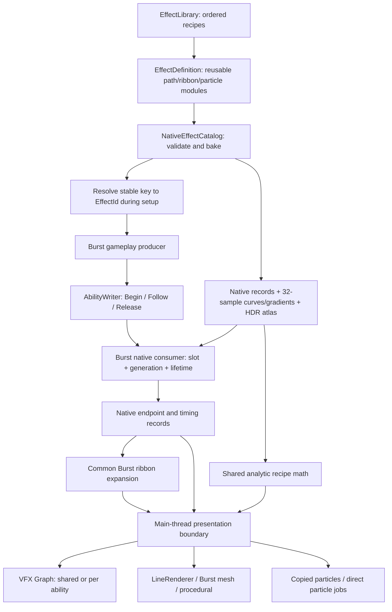

# Current code architecture

The complete-ability experiment is an authorable proof of concept: reusable Unity assets define content, a setup-time bake produces native/GPU tables, unmanaged gameplay commands drive lifecycle, and interchangeable rendering adapters draw the same recipes. The original line experiment remains separate for historical comparison.

Start with [Artist Workflow](ArtistWorkflow.md) if you want to change an effect, [Integration](Integration.md) if you want to connect an ECS, and [Production](Production.md) if you want to run the showcase or benchmark. [Adversarial Review](AdversarialReview.md) records the shortcomings that prompted this refactor. [The previous walkthrough](History/CodeOverview-v1.md) describes the historical implementation; its hardcoded styles and API examples are not the current complete-effect API.

## Reading order

1. `Authoring/EffectDefinition.cs`, `LinePathAsset.cs`, `RibbonLayerAsset.cs`, `ParticleLayerAsset.cs`: content a designer edits.
2. `Authoring/NativeEffectCatalog.cs` and `Runtime/EffectRecipeData.cs`: validation, ownership and the explicit packed contract.
3. `Runtime/AbilityHealerExample.cs` and `AbilityWorld.cs`: real gameplay producers and native lifecycle.
4. `Runtime/AbilityGeometry.cs`: shared visual vocabulary, consuming data rather than recipe names.
5. `Runtime/AbilityBackend.cs`, `CoreBackend.cs`, `ParticleSurfacePool.cs`: presentation costs and renderer packaging.
6. `Runtime/ProductionBenchmark.cs` and `Tools/production_report.py`: measurement, immutable run identity and audits.

Paths in this section are relative to `Assets/LineLab/Production/`.

## Content to pixels

`EffectDefinition` references assets; it does not select a hardcoded Renewal/Storm/Solar branch. Named motion enums select supported algorithms. A new variant, color gradient, texture, ribbon combination or mote using an existing algorithm requires asset edits. A genuinely new motion algorithm requires programmer work in the shared CPU/GPU vocabulary and regenerated HLSL.

The default reference library contains three effects. The artist library adds VoidConduit, reuses RenewalMotes and introduces a second traveling layer, different texture, reverse motion and a long tail. The preview derives display names and selection from the chosen catalog, with four choices per page. It does not assume three recipe names.

## Bake and lifetime boundaries

The catalog validates source references, unique stable keys, supported modes, ranges and finite values. It assigns session-local IDs from library order and flattens recipe/module records. Each gradient/curve gets a 32-sample lookup row. Profile textures become a linear RGBAHalf atlas, including unreadable imported textures through setup-time GPU readback. Padding duplicates tile edges; every renderer addresses the same full tile. A SHA-256 digest includes stable keys, baked records, ramps, topology and exact atlas bytes.

Native table storage is owned by the catalog. Public `EffectRecipes`, `RibbonRecipes`, `LayerRecipes` and `RampSamples` views are borrowed `NativeArray<T>.ReadOnly` values. Internal rendering adapters share underlying arrays. The Unity editor assembly is an explicitly trusted friend for validation and compilation. Public read-only views are not permission to dispose their owner while work is running.

The world borrows catalog tables and owns mutable state/queue arrays. Renderers borrow catalog/world data and own their buffers, components and temporary preparation storage. Complete all jobs and callbacks before disposal; dispose the backend, then world, then catalog. A rebuild creates fresh IDs and pools at an explicit boundary.

Each ability reserves the maximum ribbon slot count and the maximum particle count at each layer slot across its library. Unused ribbon slots have zero opacity; unused particle slots have zero count. The three reference recipes happen to allocate three 32-segment ribbons plus 48/24/8/4 secondary cards: 96 core / 180 full quads. Those are sample defaults, not structural constants. Adding a large layer affects the entire catalog's reserved work, which preview and benchmark metadata expose.

The packed tables are explicit rather than opaque byte blobs:

| Record | Data |
| --- | --- |
| `EffectRecipeData` | Tint; charge/core-release/retirement/width; path kind/displacement/frequency; motion/noise; brightness pulse; used slot counts |
| `RibbonRecipeData` | Width/opacity/whitening/phase; atlas tile and gradient/width lookup rows; HDR tint |
| `LayerRecipeData` | Motion/count/tile/color row; size/aspect/fade; travel/orbit/spin; ballistic velocity/gravity; opacity/whitening/release/size row; endpoint/height/scales |
| `float4` ramp rows | Linear RGBA gradients or scalar curve values replicated in four channels; 32 samples per row |

## Native state and frame scheduling

`AbilityWriter` is a struct containing a native parallel queue writer. Jobs send only endpoints, timestamps, handles and effect IDs. Starting an effect does not call a Unity component. The ECS owns slot assignment and monotonic generations; one authoritative producer owns each slot. Different slots can be produced concurrently. The consumer depends on every producer.

Begin rejects invalid IDs before claiming a generation. Stale commands cannot affect a reused slot. Follow updates sustained effects; first Release freezes endpoints and starts a tail. Repeated Release does not restart it. Retirement comes from the longest authored active-layer/core release. There is no managed entity reference in the render state.

One frame produces commands, calls `AbilityWorld.PreparePresentation` to consume and expand reserved ribbon slots, completes that dependency chain once, then calls `AbilityBackend.Present`. The public preparation method hides internal catalog arrays from external ECS assemblies. Direct Shuriken jobs are scheduled/completed in Unity's required particle callback. They do not execute inside gameplay writers. The common CPU expansion intentionally remains in every benchmark, including baseline and GPU methods that reconstruct their own strands.

`LineData` remains four float4 values (64 bytes): endpoints/active flag/base width, tint, and packed shape/timing. In complete-effect base records, `Shape.x` is the catalog effect index, `Shape.y` the deterministic phase, and `Shape.z/w` Begin/Release times. Expanded strand records repurpose the documented fields for ribbon slot lookup. Do not treat an expanded strand as a lifecycle record; see the code at `ExpandStrands` and `AbilityGeometry.Strand`.

## Renderer responsibilities

| Stack | Work and packaging |
| --- | --- |
| Shared VFX | One component and base endpoint buffer; graph computes core and each authored secondary slot from shared tables |
| Per-ability VFX | One pooled component per ability with individual inputs; batching off and Auto are separate techniques |
| LineRenderer | Burst prepares connected ribbon positions/gradients; component submissions scale per reserved ribbon; procedural companion supplies secondary layers |
| Burst mesh | Burst creates one combined core mesh; procedural companion supplies secondary layers |
| Procedural | Endpoint/strand uploads and GPU card reconstruction, with one stream per authored secondary slot |
| Shuriken copied particles | Shared/per-ability billboard or mesh pools; Burst builds particles and custom data, then Unity submissions copy them |
| Shuriken direct jobs | Callback jobs write Shuriken native arrays and custom data directly |
| Baseline | Same environment and command/ribbon work; no effect rendering |

The particle path sends HDR RGB through custom float data rather than `Color32`. Its alpha still passes through the particle color channel and is quantized. GPU instancing changes rendering; it does not make Shuriken simulation GPU-owned. Connected ribbon joins, gradient sampling and billboard frames still differ across renderers. These are comparable recipes, not a promise of identical pixels.

Shared methods keep fixed slots and broad bounds. Per-ability pools can deactivate after the tail. Compaction, spatial culling, LOD, collision-driven history and a saturated RTS are separate policies/workloads, not hidden benefits credited to these measurements.

## Source file map

All complete-effect entries below are under `Assets/LineLab/Production/`.

### Authoring and bake

| File | Responsibility |
| --- | --- |
| `Authoring/EffectLibrary.cs` | Ordered catalog and shared segment setting |
| `Authoring/EffectDefinition.cs` | Stable key, shared appearance/timing and reusable module references |
| `Authoring/LinePathAsset.cs` | Path mode, displacement, frequency, speed and brightness pulse |
| `Authoring/RibbonLayerAsset.cs` | Profile, HDR tint/gradient, width curve, opacity and phase |
| `Authoring/ParticleLayerAsset.cs` | Traveling, ballistic, corona or ground layer data and endpoint placement |
| `Authoring/NativeEffectCatalog.cs` | Validate, flatten/pad, sample ramps, build atlas, hash content and own native storage |
| `Authoring/AssemblyAccess.cs` | Explicitly grants trusted editor validation/compilation internal access |

### Runtime and presentation

| File | Responsibility |
| --- | --- |
| `Runtime/EffectRecipeData.cs` | EffectId, packed float4 records, limits and graph version |
| `Runtime/AbilityWorld.cs` | Value commands/writer, world ownership, Burst consumer, ribbon expansion and deterministic demo producer |
| `Runtime/AbilityHealerExample.cs` | PresentHealingJob and unmanaged per-healer presentation state |
| `Runtime/AbilityGeometry.cs` | Envelopes, paths, gradients, widths, cards and CPU-only segment interface |
| `Runtime/AbilityBackend.cs` | Complete-stack ownership, VFX adapters, secondary streams, activation and statistics |
| `Runtime/CoreBackend.cs` | LineRenderer, combined mesh and procedural core adapters and preparation jobs |
| `Runtime/EffectRenderResources.cs` | Shared GPU table copies, atlas bindings and generated material instances |
| `Runtime/EffectPropertyIds.cs` | Cached Unity property IDs outside per-ability loops |
| `Runtime/SurfaceParticles.cs` | Shared card evaluation, copied-particle builders and direct particle-array jobs |
| `Runtime/ParticleSurfacePool.cs` | Shuriken system/material/custom-stream setup, copied submissions and ownership |
| `Runtime/RecipeParticleBridge.cs` | Unity callback boundary and direct-job callback timer |
| `Runtime/ProductionController.cs` | Showcase controls, library selection, preview lifecycle, scheduling and benchmark/capture entry points |
| `Runtime/ProductionBenchmark.cs` | Suite specification, raw capture, content/suite manifests, census and summaries |
| `Runtime/ProductionArt.cs` | Original environment, props and placeholder unit construction |

### Editor tools

| File | Responsibility |
| --- | --- |
| `Editor/EffectAuthoringPresets.cs` | Creates missing sample source assets only; preserves edited assets |
| `Editor/EffectAuthoringInspectors.cs` | Context-sensitive module Inspectors |
| `Editor/EffectAuthoringWorkbench.cs` | Inline source editing, allocation summary, compilation and preview actions |
| `Editor/EffectGraphCompiler.cs` | Compile topology/capacity-specific generated graphs and materials; rebuild graph in place |
| `Editor/VfxGraphAdapter.cs` | Isolates reflection against Unity's internal graph authoring API |
| `Editor/EffectPreviewCompiler.cs` | Editor-only callback compiles newly requested preview capacity; players never author graphs |
| `Editor/ProductionAssets.cs` | Compile libraries, create a new scene explicitly, build AuthoredLab and write build manifests |
| `Editor/ProductionValidation.cs` | Native lifecycle, authored data and geometry validation |
| `Editor/AuthoringAcceptance.cs` | AssetDatabase-based authoring proof, reusable sample variants, graph GUID/source preservation and acceptance log |

### Shaders and generated content

| File | Responsibility |
| --- | --- |
| `Shaders/RecipeData.hlsl` | GPU packed-table access and sampled-ramp helpers |
| `Shaders/AbilityCommon.hlsl` | Mechanically generated shared analytic math from AbilityGeometry |
| `Shaders/AuthoredSurface.hlsl` | Common atlas/surface rendering functions |
| `Shaders/AuthoredRibbon.shader` | CPU ribbon/combined-mesh surface |
| `Shaders/AuthoredCore.shader` | Procedural core expansion |
| `Shaders/AuthoredAdornment.shader` | Procedural secondary-card expansion |
| `Shaders/AuthoredParticle.shader` | Shuriken surface, custom HDR RGB and texture tile |
| `Shaders/LegacyAbilityMath.hlsl` | Compatibility math for retained historical graphs; unused by authored renderer |
| `Shaders/ProductionCore.shader`, `ProductionAdornment.shader` | Retained historical material compatibility |

Source recipes live in `Assets/LineLab/Recipes/`; libraries live in `Assets/LineLab/Resources/Production/`. Disposable graph outputs live under `Resources/Production/Generated/<LayoutKey>_v1`. GraphVersion is explicitly v1. Cache hits preserve existing graphs unless force-rebuild is requested. Force rebuilding edits the existing graph in place, preserving its GUID. Rebuilding tables does not rewrite a scene or source texture/recipe. Custom artist graphs outside the generated folder are not compiler outputs.

### Original line experiment

These remain under `Assets/LineLab/`, outside Production.

| File | Responsibility |
| --- | --- |
| `Runtime/LineCommands.cs` | Shared LineData/LineHandle, original LineWriter/LineWorld/consumer, geometry and workload jobs |
| `Runtime/HealerExample.cs` | Original immediate-stop healer example |
| `Runtime/LineBackends.cs` | Technique enum/display names, original eleven adapters and Burst preparation |
| `Runtime/ParticleJobBridge.cs` | Original Shuriken callback bridge |
| `Runtime/LineLabController.cs` | Scenes 01/02, original UI/capture/scheduling and arena |
| `Runtime/LineBenchmark.cs` | Original suite, timing/export and shared result types |
| `Editor/LineLabAssets.cs` | Original asset/scene generation and player build |
| `Editor/LineCommandValidation.cs` | Original native command/geometry checks |
| `Editor/BackendValidation.cs` | Original technique capture helper |
| `Shaders/LineCommon.hlsl` | Original shared line math |
| `Shaders/Ribbon.shader` | Original CPU ribbon surface |
| `Shaders/ProceduralRibbon.shader` | Original procedural expansion |
| `Shaders/ParticleInstanced.shader` | Original instanced mesh-particle surface |

### Measurement and report tools

| File | Responsibility |
| --- | --- |
| `Tools/production_benchmark.ps1` | Launch visible AuthoredLab player into a fresh results directory, then audit/report |
| `Tools/production_report.py` | Audit suite/content/sample identity and aggregate complete-effect runs; retain historical report compatibility |
| `Tools/authored_index.py` | Index audited authored runs while separating failed or pending runs |
| `Tools/combine_authored_reports.py` | Assemble an explicit cross-run comparison with row provenance and matching source deltas |
| `Tools/extract_completed_prefix.py` | Retain complete condition groups from an interrupted run without changing its failed parent |
| `Tools/Templates/authored_index.html` | Showcase/report entry page, method limits and visual example |
| `Tools/Templates/production_report.html` | Complete-effect report presentation and filters |
| `Tools/sync_ability_math.py` | Translate shared recipe methods to HLSL; --check detects drift |
| `Tools/benchmark.ps1` | Original line-only standalone runner |
| `Tools/audit_results.py` | Original line-only matrix/raw-data audit |
| `Tools/report.py` | Original line-only aggregation and report output |
| `Tools/Templates/line_report.html` | Original line-only interactive report |

## Measurement interpretation

The benchmark times producer/consumer/expansion scheduling through completion, then explicit presentation calls plus direct-particle callback time. Whole-frame CPU/main/render-thread/present-wait and GPU timings come from Unity FrameTimingManager. GPU delta subtracts a matching baseline's whole-frame median; it is not an isolated timestamp around an effect pass.

GPU samples arrive asynchronously and require a fresh nonzero timestamp. A CSV row's CPU timer and delayed GPU timing need not belong to the same rendered frame. Use aggregates, not row-by-row causal attribution. Whole-frame counters and calculated explicit upload bytes have separate meanings; see [Methodology](Methodology.md) and the current [Production guide](Production.md).

Historical results describe their historical binaries/content. New authored manifests identify a different implementation and catalog. New scale measurements must pass their own audit before any performance conclusions are attached to this refactor.
