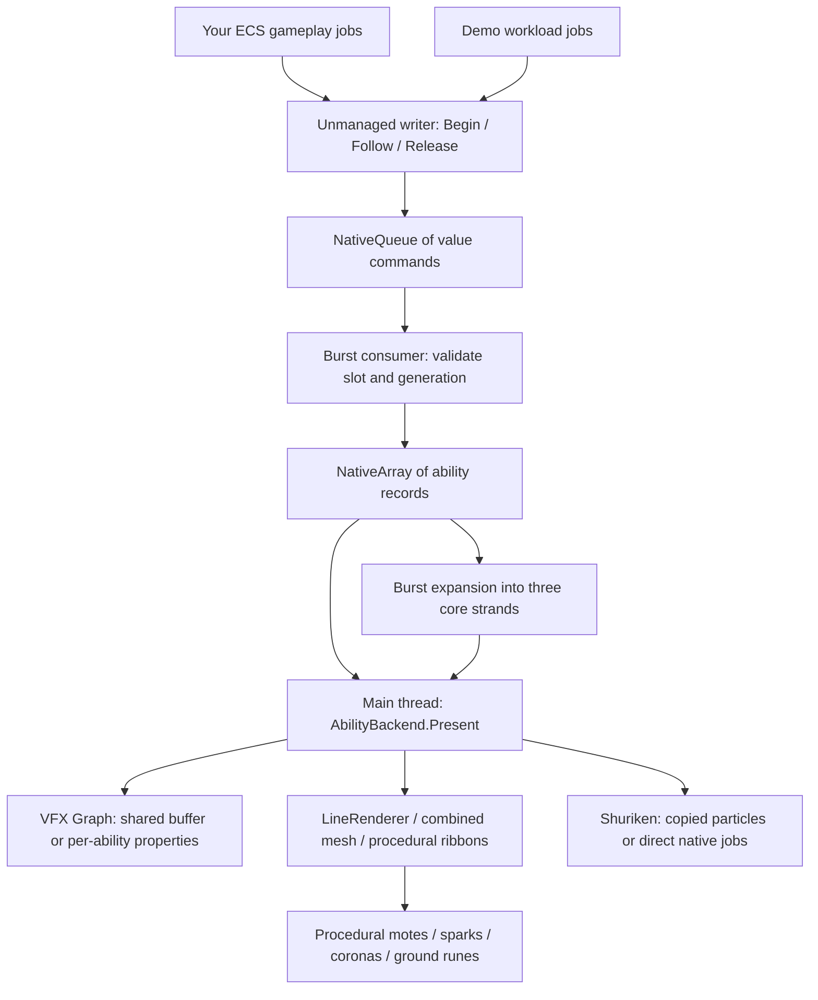

# Project code walkthrough

Archived walkthrough of the earlier hardcoded implementation. Some linked files have since been refactored; the current architecture and APIs are described in [Code Overview](../CodeOverview.md). The former particle bridge files listed below were replaced by the shared recipe particle bridge.

This project contains two experiments using the same gameplay-to-rendering architecture: the original line comparison, and the newer AETHER complete-ability comparison. Start with the complete-ability implementation if you want to understand what you would integrate into an RTS. The original implementation makes the simpler rendering differences easier to study.

The readability pass expands compact code, gives control flow explicit braces, separates variable declarations, expands method bodies, documents the main boundaries, and formats the shaders and tools. The native data layout, rendering recipes, workload, and measurement protocol retain their behavior. The report UI now lives in separate HTML templates. The geometry translator now tolerates normal C# formatting and provides a `--check` command.

## Suggested reading order

1. Read the native API and consumer in [AbilityWorld.cs](<C:/Unity Projects/VFX Graph Tryout/Assets/LineLab/Production/Runtime/AbilityWorld.cs>).
2. Read `ProductionController.Update` in [ProductionController.cs](<C:/Unity Projects/VFX Graph Tryout/Assets/LineLab/Production/Runtime/ProductionController.cs>) to see the entire frame dependency chain.
3. Read [AbilityGeometry.cs](<C:/Unity Projects/VFX Graph Tryout/Assets/LineLab/Production/Runtime/AbilityGeometry.cs>) to understand how the visual is constructed.
4. Read the constructor and `Present` in [AbilityBackend.cs](<C:/Unity Projects/VFX Graph Tryout/Assets/LineLab/Production/Runtime/AbilityBackend.cs>), followed by the corresponding branches in [CoreBackend.cs](<C:/Unity Projects/VFX Graph Tryout/Assets/LineLab/Production/Runtime/CoreBackend.cs>).
5. Read [ProductionBenchmark.cs](<C:/Unity Projects/VFX Graph Tryout/Assets/LineLab/Production/Runtime/ProductionBenchmark.cs>) and [production_report.py](<C:/Unity Projects/VFX Graph Tryout/Tools/production_report.py>) to understand the evidence behind the comparison.

You do not need to understand the environment generator, user interface, benchmark export, or VFX reflection helpers before using the native command API.

## The architecture



Gameplay sends world-space values. It never needs a `GameObject`, `Transform`, `VisualEffect`, `LineRenderer`, or `ParticleSystem`. A writer is a struct containing a `NativeQueue<T>.ParallelWriter`, suitable for passing into Burst jobs. Calling `Begin` enqueues a command; it does not immediately create a Unity component.

`AbilityWorld` and `LineWorld` are managed ownership classes that allocate and dispose persistent native storage. That does not make the gameplay calls managed: jobs receive their small writer structs, not the owner objects. Unity component calls, graphics-buffer uploads and draw submissions happen later in the managed presentation layer on the main thread. The queue uses native storage and can grow; unmanaged commands do not mean every possible native allocation is eliminated.

The renderer is selected when presentation is configured. The gameplay-facing commands are identical for all techniques. Pool allocation happens during setup; the benchmark measures that separately from steady-state updates.

## The data record

[LineCommands.cs](<C:/Unity Projects/VFX Graph Tryout/Assets/LineLab/Runtime/LineCommands.cs>) declares the shared `LineData` struct. Its four `float4` fields occupy 64 bytes, with the same layout in C# and HLSL.

| Field | Original line experiment | Complete ability experiment |
|---|---|---|
| `Start.xyz` | Source world position | Source world position |
| `Start.w` | Active flag | Active flag, including the release-tail period |
| `End.xyz` | Target world position | Target world position |
| `End.w` | Ribbon width | Base ribbon width before strand expansion |
| `Color` | Tint and opacity | Tint and opacity |
| `Shape.x` | Heal / arc / plasma / order style | Renewal / Storm Lance / Solar Tether style |
| `Shape.y` | Deterministic phase | Deterministic phase, offset per strand |
| `Shape.z` | Reserved | Begin time |
| `Shape.w` | Reserved | Release time; `-10000` means sustained |

There is no entity reference inside the GPU record. Entity identity and target validity belong to your ECS; it resolves positions before sending commands. The small packed record keeps the native and GPU paths comparable, but means the meaning of each component matters when extending the effect.

## A healer's lifecycle

The original, executable Burst example is [HealerExample.cs](<C:/Unity Projects/VFX Graph Tryout/Assets/LineLab/Runtime/HealerExample.cs>). `HealerState` stores a source position, target index, allocated line slot, generation, desired healing state and previous visual state. `HealerLinesJob` checks whether the target index exists, starts a line when healing begins, updates endpoints while healing continues, and stops the line when healing ends. Replace its arrays and target-index check with your ECS component access and identity/liveness checks.

The complete-ability equivalent uses the same handle type with a different writer:

```csharp
// These calls belong inside your Burst gameplay jobs.
// Store the slot, generation and active flag in your ECS component.
// The ECS must assign exclusive ownership of each slot.

// Healing starts. First generation is 1 for AbilityWorld.
generation++;
var handle = new LineHandle(slot, generation);
abilities.Begin(handle, sourcePosition, targetPosition, style: 0, time: clock);

// Subsequent gameplay ticks while healing remains active.
abilities.Follow(handle, sourcePosition, targetPosition);

// Healing ends, the target dies, or the cast is interrupted.
abilities.Release(handle, time: clock);
```

These are lifecycle branches, not three calls to issue together every frame. `abilities` is an `AbilityWriter` copied into the producer job. Style 0 selects Renewal, 1 Storm Lance, and 2 Solar Tether in the demo recipe.

A `LineHandle` is a slot plus a generation. The slot identifies storage; the generation identifies the current owner of that storage. If slot 12 has been reused at generation 8, an old release for generation 7 cannot stop its new effect. The ECS owns slot assignment and monotonically increasing generations; the project does not implement an entity allocator. Do not wrap the generation counter and expect stale-command protection to continue working.

`ConsumeAbilities` performs these transitions:

| Incoming command / state | Result |
|---|---|
| Begin with a newer generation | Initialize endpoints, color, phase and Begin time; replace the previous occupant |
| Begin with an old or equal generation | Ignore it |
| Follow with the current generation, while sustained | Update endpoints |
| First Release with the current generation | Store the release time and retain the last endpoints |
| Repeated Release | Keep the original release time |
| Follow after Release | Keep the frozen endpoints |
| Release tail older than 1.4 seconds | Mark the slot inactive |
| Invalid slot or stale generation | Ignore the command |

The original `LineWorld` has an immediate `Stop` instead of a retained tail. Its separate `Initialized` array allows generation zero for the first Begin; `AbilityWorld` expects its first generation to exceed the initially zero generation array.

Use one authoritative producer per slot. Parallel enqueues from different jobs do not establish a meaningful cross-producer ordering for conflicting commands on the same slot. Schedule the consumer after all producers; sending commands while it consumes the queue is not this design's usage pattern.

## One complete frame

`ProductionController.Update` is the concrete scheduling example:

1. `PlayAbilities` produces deterministic Begin/Follow/Release commands in parallel. Your game replaces this job with actual gameplay producers.
2. `World.Consume(produced, time)` schedules the single Burst consumer after those producers.
3. `ExpandStrands` runs after consumption and creates three ribbon records per ability. One completion boundary makes the arrays ready for presentation.
4. `Backend.Present(World, time, first)` reads completed state and performs renderer-specific Unity work.
5. For direct Shuriken jobs, Unity later calls `OnParticleUpdateJobScheduled`; its bridge schedules and completes the native particle update there.

```csharp
// Setup on the presentation side, once for a fixed-capacity pool.
var world = new AbilityWorld(capacity);
var backend = new AbilityBackend(Technique.VfxBuffer, capacity, camera, full: true);

// Per presentation frame. producerHandle includes every gameplay producer.
JobHandle consumed = world.Consume(producerHandle, clock);
new ExpandStrands
{
    Lines = world.Lines,
    Strands = world.Strands,
    Clock = clock
}.Schedule(capacity * 3, 64, consumed).Complete();

backend.Present(world, clock, firstFrame);

// On shutdown, after outstanding jobs/callbacks have finished:
backend.Dispose();
world.Dispose();
```

`CommandsMs` measures scheduling, consuming, strand preparation and completion together in the complete-ability host. `BridgeMs` measures presentation plus the last completed particle-callback duration. A Burst job's `Complete()` is a synchronization boundary; these timers are wall times, not a sum of active CPU cycles across cores.

The common CPU strand expansion runs even when a VFX graph derives strands itself, so every benchmark includes the same common native work. A VFX-only integration can omit unused CPU strand preparation. In this implementation the procedural core uploads three expanded records, while shared VFX uploads one base record; that is an implementation choice documented in the results.

Dispose the backend before the world and ensure outstanding work is finished before freeing native arrays. The bridge `Ready` flags prevent subsequent callbacks from consuming disposed input. Do not retain and use a writer after its world is disposed.

## How the complete effect is built

[AbilityGeometry.cs](<C:/Unity Projects/VFX Graph Tryout/Assets/LineLab/Production/Runtime/AbilityGeometry.cs>) defines a deterministic recipe that both CPU and GPU backends reproduce.

| Function | Responsibility |
|---|---|
| `Hash` | Stable pseudo-random variation without allocating a random object |
| `Palette` | The three ability colors |
| `LayerCount` | Particle/card count for each secondary layer |
| `Envelope` | Charge-up and release fade from the timestamps |
| `Strand` | Turn a base record into the bright core, broad glow or thin accent |
| `Point` | Sample the style's curved, oscillating or electrical path |
| `Tint` | Pulse the color along that path |
| `Decor` | Compute a secondary card's position, orientation, size, color and alpha |
| `Segment` | Convert consecutive path samples into a core card for CPU renderers |

Each complete ability has three 32-segment ribbons, 48 travelling motes, 24 sparks, eight endpoint-corona cards and four ground-rune cards: 180 quads. Core-only retains 96 quads. Coronas are several textured surfaces layered at the endpoints; runes lie in the ground plane. All travel and spark motion is computed from time, seed and endpoints rather than accumulated particle history. This keeps recipes reproducible across techniques; it does not implement arbitrary historical trails or collision-driven smoke.

`Tools/sync_ability_math.py` translates the shared portion into `AbilityCommon.hlsl`. Edit the C# recipe, regenerate, and check synchronization:

```powershell
python Tools/sync_ability_math.py
python Tools/sync_ability_math.py --check
```

The translator is intentionally limited to these shared methods. It replaces C# constructors and math names, converts default initialization and expression bodies, and prefixes GPU function names. It is not a general C# compiler. The CPU-only `Segment` marker ends the translated section. Comments and whitespace do not affect `--check`.

## What each renderer does

`Technique` and its display names live in `LineBackends.cs`. Both experiments use that enum. `AbilityBackend` owns the complete stack; non-VFX branches delegate their three ribbons to `CoreBackend`.

| Technique | State submission and expansion | Complete effect packaging |
|---|---|---|
| `VfxBuffer` | Upload base records to one shared `GraphicsBuffer`; the GPU computes geometry | One VFX component containing core, motes, sparks, coronas and runes |
| `VfxPerLine` | Set endpoint/tint/shape properties on pooled VFX components | One five-system graph per ability, instance batching disabled |
| `VfxPerLineBatched` | Same per-ability property path | Same pool with graph instance batching set to Auto |
| `LineRenderer` | Burst prepares positions and gradient samples; main thread submits each component | Three LineRenderers per ability plus a four-layer procedural companion |
| `BurstMesh` | Burst writes vertices into native storage; main thread uploads one mesh | One combined core mesh plus the procedural companion |
| `Procedural` | Upload ribbon records and submit a procedural draw; vertex shader expands cards | One core draw plus four secondary-layer draws |
| `ParticleBillboardShared` | Burst builds native particle records; submit shared arrays with `SetParticles` | Shared core and four shared secondary systems; runes use world-oriented mesh cards |
| `ParticleBillboardPerLine` | Submit slices to pooled systems | One core system and four secondary systems per ability |
| `ParticleMeshShared` | Same native particle preparation, ordinary mesh-particle rendering | Shared systems using quad meshes |
| `ParticleMeshInstanced` | Same CPU particle state; compatible shader enables GPU-instanced rendering | Shared instanced mesh-particle systems |
| `ParticleJobs` | Initialize particles once, then write Unity particle arrays from Burst callbacks | Shared core and four direct-job secondary systems |
| `Baseline` | Run the same native command and strand jobs | Same environment, no effect renderers |

The implementation uses fixed pools and broad bounds. Invisible shared slots can still execute shader/particle work; there is no active-slot compaction or spatial partitioning. Per-ability VFX disables its component after retirement. Per-ability Shuriken disables its core but retains secondary pools with invisible particles. These differences are part of what was measured.

`UploadBytes` records explicit bulk API input estimates. It does not measure PCIe traffic, hidden Unity transfers, shader-property overhead, or isolated GPU memory. `InstancingActive` checks the configured setting; it is not a hardware draw-call trace. `ObjectCount` and live particle counts are collected outside the per-frame hot path for benchmark summaries.

## VFX graph authoring

The VFX assets are real graphs generated by the Editor code. Open them in the VFX Graph window to inspect the system layout. Unity owns their serialized representation; use the graph editor or generator rather than formatting the YAML.

The complete graphs have five columns: core, motes, sparks, coronas and runes. Each column contains Spawn, Initialize, Update and Output contexts. A one-time burst allocates fixed particles. Aging, reaping and automatic integration are disabled; the Custom HLSL update calculates attributes analytically every frame. `particleId` selects the ability, strand or secondary card.

Shared graphs read `Lines`; per-ability graphs read `Start`, `End`, `Tint` and `Shape`. Both use `Clock` and `CameraPosition`. `SpawnCore` and `SpawnLayer0`–`SpawnLayer3` select allocation counts. Shared capacity variants avoid allocating the largest pool for every small test. The complete shared variants cover powers of two through 512 abilities. A larger shared pool needs matching generated capacity assets.

The generators use reflection because the graph authoring model is internal to the installed VFX package. Their `T`, `Call`, `Get`, `Set`, `Node`, `Slot`, `Parameter` and `Connect` helpers find model types, edit settings and link slots. Reflection is Editor-only. Players load compiled assets and use public rendering APIs; gameplay jobs do not execute the graph generator.

## All authored Unity source files

### Original line experiment

| File | What lives here |
|---|---|
| [Runtime/LineCommands.cs](<C:/Unity Projects/VFX Graph Tryout/Assets/LineLab/Runtime/LineCommands.cs>) | `LineData`, handles and commands; `LineWriter`; native ownership and consumer; shared CPU line geometry; static/moving/churn/overdraw producers |
| [Runtime/HealerExample.cs](<C:/Unity Projects/VFX Graph Tryout/Assets/LineLab/Runtime/HealerExample.cs>) | Renderer-independent Burst healer state and lifecycle example |
| [Runtime/LineBackends.cs](<C:/Unity Projects/VFX Graph Tryout/Assets/LineLab/Runtime/LineBackends.cs>) | Technique enum/names; LineRenderer, ribbon-vertex and particle preparation jobs; direct particle update job; setup, presentation and disposal branches for every original renderer |
| [Runtime/ParticleJobBridge.cs](<C:/Unity Projects/VFX Graph Tryout/Assets/LineLab/Runtime/ParticleJobBridge.cs>) | Unity callback host for direct native Shuriken writes and its callback timer |
| [Runtime/LineLabController.cs](<C:/Unity Projects/VFX Graph Tryout/Assets/LineLab/Runtime/LineLabController.cs>) | Hosts scenes 01/02, schedules jobs, presents results, updates controls/captures; `LabArena` constructs the original arena and placeholder units |
| [Runtime/LineBenchmark.cs](<C:/Unity Projects/VFX Graph Tryout/Assets/LineLab/Runtime/LineBenchmark.cs>) | Shared metadata/sample/result types, original workload matrix, timing capture, raw export, validity checks and standalone visual captures |
| [Editor/LineLabAssets.cs](<C:/Unity Projects/VFX Graph Tryout/Assets/LineLab/Editor/LineLabAssets.cs>) | Original textures, materials, VFX graphs, capacity variants, showcase decoration, scenes and Windows player build |
| [Editor/LineCommandValidation.cs](<C:/Unity Projects/VFX Graph Tryout/Assets/LineLab/Editor/LineCommandValidation.cs>) | Native command lifecycle, stale-generation, parallel-producer and degenerate-geometry checks |
| [Editor/BackendValidation.cs](<C:/Unity Projects/VFX Graph Tryout/Assets/LineLab/Editor/BackendValidation.cs>) | Editor-only helper to configure a method, simulate, capture an image and report live particles/objects/instancing |

### Complete-ability experiment

| File | What lives here |
|---|---|
| [Runtime/AbilityWorld.cs](<C:/Unity Projects/VFX Graph Tryout/Assets/LineLab/Production/Runtime/AbilityWorld.cs>) | Begin/Follow/Release value commands, parallel writer, native ownership, generation-safe consumer, release retirement, strand expansion and demo producers |
| [Runtime/AbilityGeometry.cs](<C:/Unity Projects/VFX Graph Tryout/Assets/LineLab/Production/Runtime/AbilityGeometry.cs>) | Shared CPU ability recipes and secondary-card data; source for generated GPU math |
| [Runtime/AbilityBackend.cs](<C:/Unity Projects/VFX Graph Tryout/Assets/LineLab/Production/Runtime/AbilityBackend.cs>) | Complete VFX ownership; non-VFX core delegation; procedural or Shuriken decoration; copied and direct native decoration jobs; accounting and disposal |
| [Runtime/CoreBackend.cs](<C:/Unity Projects/VFX Graph Tryout/Assets/LineLab/Production/Runtime/CoreBackend.cs>) | Richer core geometry jobs and presentation branches adapted from the original backend |
| `Runtime/CoreParticleBridge.cs` (historical, removed) | Required Unity callback for direct core particle jobs |
| `Runtime/DecorParticleBridge.cs` (historical, removed) | Required Unity callback for each direct secondary-layer particle job |
| [Runtime/ProductionController.cs](<C:/Unity Projects/VFX Graph Tryout/Assets/LineLab/Production/Runtime/ProductionController.cs>) | Scene 03 host; configures pools; schedules native work; camera/UI/focus/capture controls; dispatches automated benchmark/capture modes |
| [Runtime/ProductionBenchmark.cs](<C:/Unity Projects/VFX Graph Tryout/Assets/LineLab/Production/Runtime/ProductionBenchmark.cs>) | Complete-effect matrix and timing/export protocol; extends shared result types with full-stack composition and allocated-quad counts |
| [Runtime/ProductionArt.cs](<C:/Unity Projects/VFX Graph Tryout/Assets/LineLab/Production/Runtime/ProductionArt.cs>) | Builds outpost geometry, props and armored units from generated resources; used during Editor scene generation |
| [Editor/ProductionAssets.cs](<C:/Unity Projects/VFX Graph Tryout/Assets/LineLab/Production/Editor/ProductionAssets.cs>) | Generates profiles, textures, terrain/rock/bevel meshes, materials, graphs, atmosphere and scene 03; builds its separate standalone player |
| [Editor/ProductionValidation.cs](<C:/Unity Projects/VFX Graph Tryout/Assets/LineLab/Production/Editor/ProductionValidation.cs>) | Ten checks covering unmanaged starts, frozen release endpoints, tails, stale commands, parallel producers and skipped-frame lifecycle boundaries |

`CoreBackend` deliberately parallels `LineBackend` so the complete experiment could change its recipe without changing the original comparison's behavior. This is duplicated experiment code, not two backends you must carry into your RTS. `AbilityBackend` handles the complete VFX path itself; its VFX use does not go through `CoreBackend`. For integration, retain the backend you select and remove unused experiment branches as appropriate.

## Shader source files

| File | Purpose |
|---|---|
| [Shaders/LineCommon.hlsl](<C:/Unity Projects/VFX Graph Tryout/Assets/LineLab/Shaders/LineCommon.hlsl>) | Original GPU equivalents of line curve/tint functions, used by VFX Custom HLSL and the original procedural shader |
| [Shaders/Ribbon.shader](<C:/Unity Projects/VFX Graph Tryout/Assets/LineLab/Shaders/Ribbon.shader>) | Draw submitted geometry using vertex color and the cross-section texture; shared by mesh/LineRenderer and suitable particle material paths |
| [Shaders/ProceduralRibbon.shader](<C:/Unity Projects/VFX Graph Tryout/Assets/LineLab/Shaders/ProceduralRibbon.shader>) | Original GPU ribbon expansion from vertex/instance IDs and the line buffer |
| [Shaders/ParticleInstanced.shader](<C:/Unity Projects/VFX Graph Tryout/Assets/LineLab/Shaders/ParticleInstanced.shader>) | Particle instancing setup, transform and packed-color decoding; matches the configured Position/Color/UV particle stream |
| [Production/Shaders/AbilityCommon.hlsl](<C:/Unity Projects/VFX Graph Tryout/Assets/LineLab/Production/Shaders/AbilityCommon.hlsl>) | Generated GPU equivalent of the common ability recipe |
| [Production/Shaders/ProductionCore.shader](<C:/Unity Projects/VFX Graph Tryout/Assets/LineLab/Production/Shaders/ProductionCore.shader>) | GPU expansion of the complete experiment's core ribbons |
| [Production/Shaders/ProductionAdornment.shader](<C:/Unity Projects/VFX Graph Tryout/Assets/LineLab/Production/Shaders/ProductionAdornment.shader>) | Expand each secondary-layer card from `AbilityDecor` and its vertex/instance IDs |

The effect shaders use additive blending (`SrcAlpha One`), disable depth writes and draw both faces. Profile textures create the bright center and softer falloff. Bloom and color grading belong to the scene's URP volume. The ribbon, procedural and particle paths can have different joins, interpolation, orientation and color precision even with matching recipes; the findings discuss these differences.

The procedural vertex shaders recompute a card recipe for each vertex invocation. VFX updates particle attributes in compute and then renders them. The practical performance comparison includes that distinction.

## Benchmarks and report tooling

| File | Purpose |
|---|---|
| [Tools/benchmark.ps1](<C:/Unity Projects/VFX Graph Tryout/Tools/benchmark.ps1>) | Launch the original visible standalone player, select smoke/full, wait for completion and generate its report |
| [Tools/production_benchmark.ps1](<C:/Unity Projects/VFX Graph Tryout/Tools/production_benchmark.ps1>) | Launch the complete-ability player, retain per-run output/logs and generate its audited report |
| [Tools/audit_results.py](<C:/Unity Projects/VFX Graph Tryout/Tools/audit_results.py>) | Independently validate original run completeness, configurations, raw counts, fresh timing stamps, medians and instancing/particle checks |
| [Tools/report.py](<C:/Unity Projects/VFX Graph Tryout/Tools/report.py>) | Aggregate original repetitions, pair baselines, derive raw-frame statistics, include allocation/legacy comparisons, and emit offline JSON/CSV/HTML |
| [Tools/production_report.py](<C:/Unity Projects/VFX Graph Tryout/Tools/production_report.py>) | Audit complete-effect raw data, aggregate repetitions, calculate paired GPU deltas and layer costs, and emit JSON/CSV/HTML |
| [Tools/sync_ability_math.py](<C:/Unity Projects/VFX Graph Tryout/Tools/sync_ability_math.py>) | Translate shared C# math to HLSL; `--check` verifies current generated math without writing |
| [Tools/Templates/line_report.html](<C:/Unity Projects/VFX Graph Tryout/Tools/Templates/line_report.html>) | Original report markup/CSS/JavaScript: filtering, tables, scaling charts, churn traces, visual comparison and CSV download |
| [Tools/Templates/production_report.html](<C:/Unity Projects/VFX Graph Tryout/Tools/Templates/production_report.html>) | Complete report markup/CSS/JavaScript: case table, scaling chart, full/core layer comparison, captures and CSV download |

The templates use `__DATA__`, `__META__` and other explicit replacement markers. The Python tools load them relative to their own location and embed the data. Generated reports are self-contained HTML with local screenshot references; no web server or JavaScript build step is needed. Keep the Templates folder with the Python tools if copying them elsewhere. Python tools require only the standard library at runtime.

For each cell, the C# runner sets the resolution/configuration, warms up the renderer, captures raw frames, rejects invalid output and exports a summary. Technique order is deterministically shuffled. The complete full matrix contains 360 cells with three repetitions, 120 warmup frames and 240 measured frames per cell. The original full matrix contains 900 cells per implementation revision. Smoke suites check functionality and accounting rather than establishing the final performance ranking.

| Measurement | Interpretation |
|---|---|
| Frame time / p95 | Player frame interval and its slower-frame behavior |
| Main/render CPU time | Whole-frame engine timing, including work outside the submission bridge |
| Command time | Host's native production/consumption/preparation scheduling and completion wall time |
| Bridge time | Explicit presentation wall time, including preparation inside that bridge and the last completed particle callback |
| GPU time | Fresh whole-frame timing samples, not isolated renderer pass timing |
| GPU delta | Technique minus its matching environment/native-work baseline; subject to measurement noise |
| GC / memory / batches / SetPass | Available engine counters; unsupported values remain missing |
| Setup / objects / live particles / bulk input bytes | Pool/setup and implementation accounting, not isolated GPU VRAM or bus measurements |

The runner checks timestamps so repeated GPU timing results are not counted as fresh samples. The Python audits recompute medians from the raw data and verify sample/configuration accounting. CPU/GPU frames overlap; adding their timings is not a valid total frame cost. A subtraction from baseline estimates incremental GPU cost but is not a timestamp placed around an individual effect draw.

The measured players, raw results and their historical manifests are retained. Formatting changes current source hashes, so those historical manifests identify the source snapshot used for the old measurements; they are not silently replaced with hashes of reformatted source. This readability pass does not claim new performance measurements.

## Scenes, resources and project infrastructure

| Location | Responsibility |
|---|---|
| `Assets/LineLab/Scenes/01_VFX_Showcase.unity` | Original VFX showcase; its decorative graph is excluded from matched original benchmarks |
| `Assets/LineLab/Scenes/02_Technique_Lab.unity` | Original interactive technique/workload comparison |
| `Assets/LineLab/Scenes/03_Complete_Abilities.unity` | AETHER complete-ability comparison with matching secondary layers across methods |
| `Assets/LineLab/Resources` | Runtime-loadable original materials, profiles, quad mesh and VFX capacity variants |
| `Assets/LineLab/Resources/Production` | Complete graphs, profiles, materials, meshes and atmosphere |
| `Builds/LineLab` / `Builds/ProductionLab` | Separate measured standalone players |
| `BenchmarkResults` | Historical raw/summary data, audits, manifests and generated reports |
| `Documentation` | Integration, methodology, measured findings and this code walkthrough |
| `Screenshots` / `Assets/Screenshots` | Captures and visual evidence, rather than runtime systems |
| `Assets/Settings`, `ProjectSettings`, `Packages` | URP, player/build/input/frame-timing settings and package versions |
| `Assets/TutorialInfo/Scripts/Readme.cs` and `Editor/ReadmeEditor.cs` | Stock Unity template welcome-page metadata and Inspector UI; unrelated to the experiment |
| `Library`, `Temp`, `obj`, generated `.csproj`/`.sln` | Editor caches and generated tooling files; not gameplay source |

The runtime has no dependency on Unity Entities or the CLI/Pipeline tooling. Burst, Collections, Jobs, Mathematics, VFX Graph and URP supply its native execution and rendering facilities; Input System supplies demo controls. Unity's package code is external infrastructure, not authored LineLab source.

## Where to make a change

| Desired change | Start here |
|---|---|
| Integrate your ECS | Copy the writer into gameplay jobs, allocate slots/generations in the ECS, and replace `PlayAbilities` |
| Change start/follow/release rules | `AbilityWorld.cs` and its lifecycle validation |
| Change motion, timing, palette or secondary shapes | `AbilityGeometry.cs`, then regenerate HLSL |
| Change allocation counts or graph capacities | `LayerCount`, graph generator, spawn/indexing code and benchmark quad accounting must remain consistent |
| Change the number of core strands or segments | `ExpandStrands`, core/backend counts, VFX indexing, procedural geometry and measurement accounting |
| Change visual textures/materials/lighting | `ProductionAssets.cs`; use Editor menus to regenerate intentionally |
| Change outpost or unit construction | `ProductionArt.cs`; regenerate the scene intentionally |
| Compare another renderer | Add the enum/name, implement presentation, then check both matrix/report support and matched geometry |
| Change test cases or timing protocol | The relevant C# benchmark runner and matching Python audit expectations |
| Change report appearance or interaction | The relevant HTML template |

Asset generation replaces generated resources/scenes. Use it when changing authoring recipes, rather than as a prerequisite for reading or using existing assets. Formatting scripts does not require regenerating the scene or measured players.

## Keeping the code readable

`.editorconfig` records indentation, brace and newline conventions. `.csharpierrc.json` and `.config/dotnet-tools.json` pin the C# formatting convention and formatter version. From the project root, with the .NET SDK installed:

```powershell
dotnet tool restore
dotnet tool run csharpier format Assets/LineLab
dotnet tool run csharpier check Assets/LineLab
python Tools/sync_ability_math.py --check
```

CSharpier maintains layout; keep new control flow braced and new variables individually declared when writing code. Python, shader and report-template formatters are authoring conveniences and are not Unity/player runtime dependencies. Keep `AbilityCommon.hlsl` synchronized whenever editing the shared recipe.
